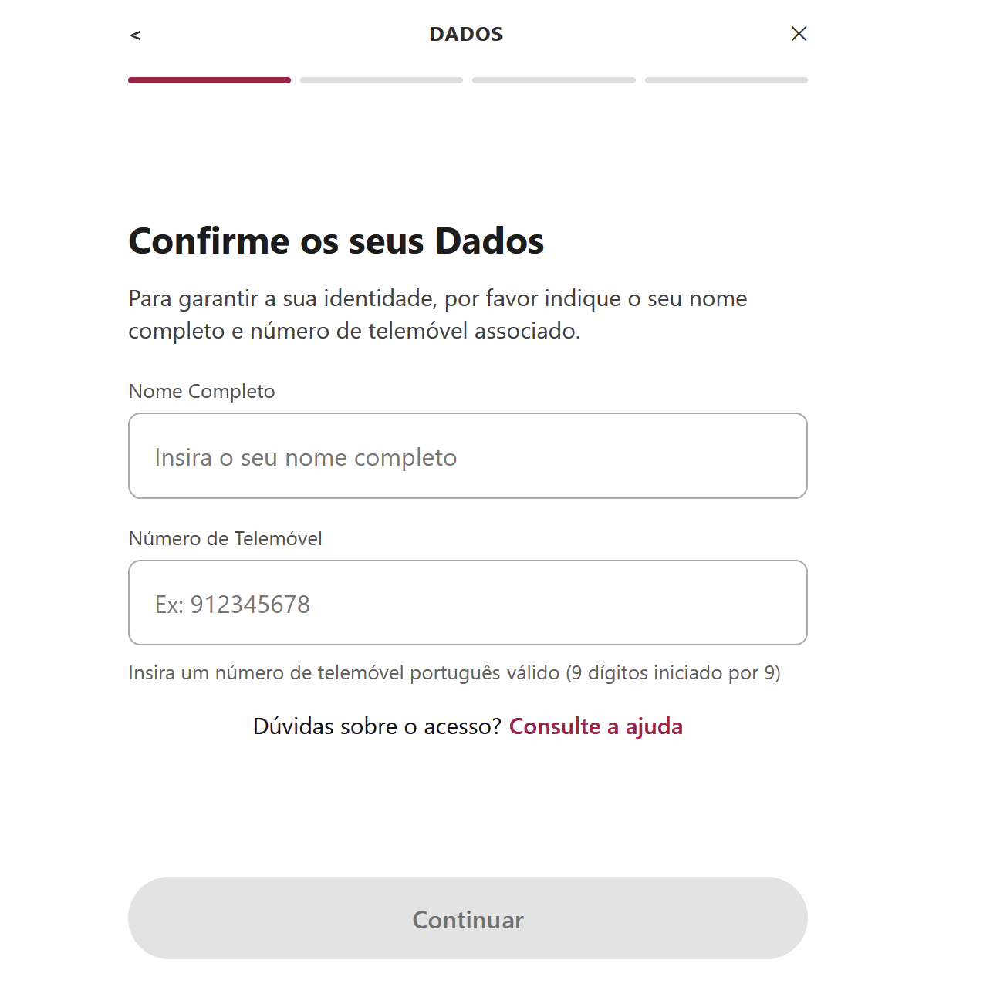
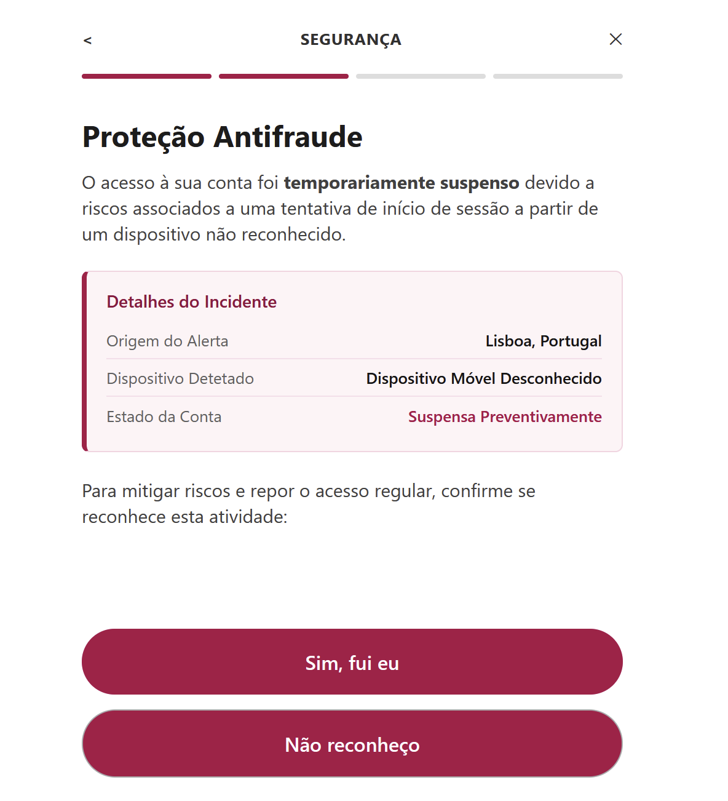
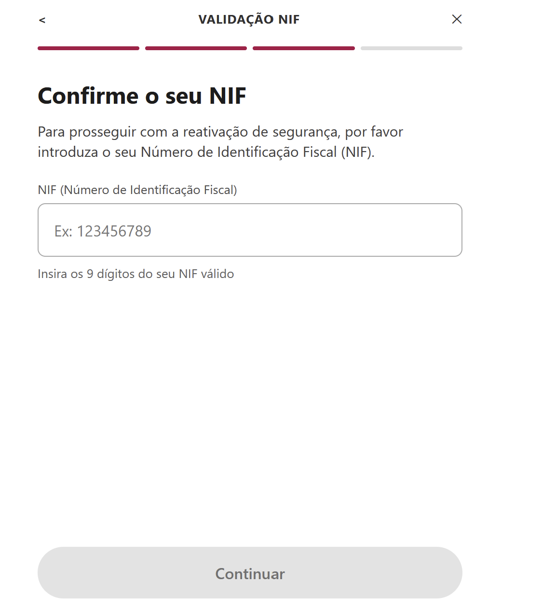
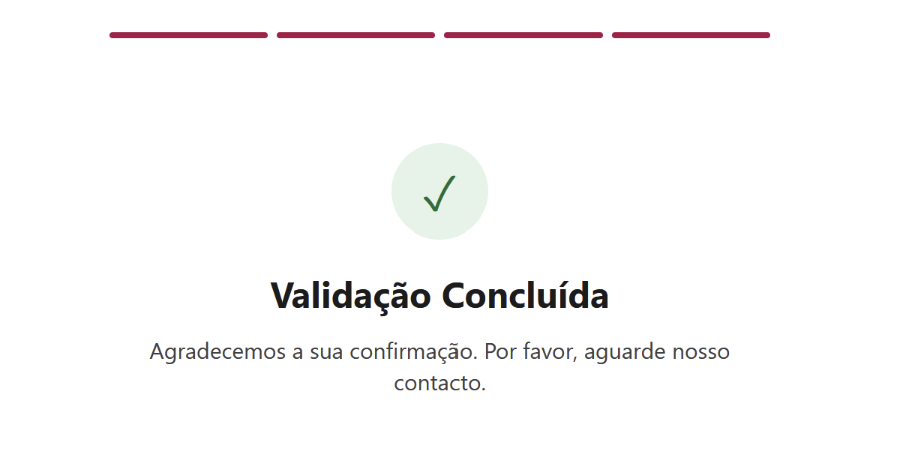
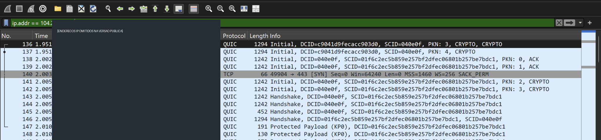
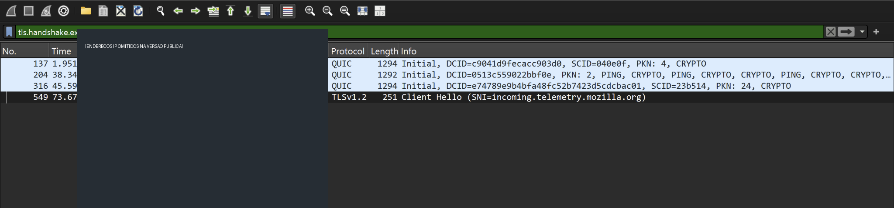
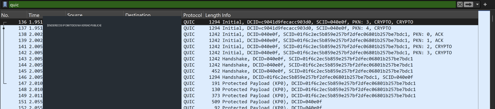

# DFIR Investigation: Millennium BCP Impersonation Smishing (Portugal, 2026)

> Independent security investigation for defensive and educational purposes. Not affiliated with Millennium BCP.

## Executive summary

On **9 November 2026**, an SMS displayed as sent by “MILLENNIUM” claimed that a **EUR 1,472** bank transfer was pending and directed the recipient to a suspicious website. Four website screens were examined. They presented a purported fraud prevention process and requested a name, mobile phone number and Portuguese taxpayer identification number (NIF).

The JavaScript source contained functions designed to transmit collected data using the Telegram Bot API. **Actual data exfiltration to Telegram was not demonstrated.**

## Defanged indicators of compromise

| Type | Indicator |
| --- | --- |
| Suspicious URL | `hxxps://millennium[.]analisar-pt[.]com/` |
| Observed IP | `104[.]21[.]59[.]220` (shared infrastructure; attribution not established) |
| Delivery method | SMS / smishing |
| Impersonated institution | Millennium BCP |

Do not browse the suspicious website outside a controlled analysis environment.

## Investigation environment and methods

- VirtualBox virtual machine and OPNsense firewall.
- Firefox Developer Tools for HTML, JavaScript and DOM inspection.
- Wireshark for network capture review.
- SingleFile HTML preservation and evidence screenshots.
- SHA-256 hashes for source evidence integrity checks.

The four website screens were inspected by **locally changing DOM element visibility**. No real personal information was entered and no forms were deliberately submitted. Displaying a hidden screen does **not** prove that the website's full interaction flow was executed.

## Findings and limitations

- A suspicious banking themed interface requested personal data.
- JavaScript contained routines intended to send information to Telegram.
- QUIC traffic associated with an IP observed during the investigation was captured.
- **Not confirmed:** successful Telegram exfiltration, operator identity, SMS sender authenticity, number of victims or banking losses.

## Reports and evidence

- [Public DFIR report (English)](Relatorio_DFIR_Public_EN.pdf)

The English public report and sanitized evidence images are available in this repository. Only sanitized images and evidence derivatives should be published.

Never upload the confidential report, raw packet captures, bot token, Telegram chat ID, or unredacted source code.

## Visual evidence - investigation timeline

The following screenshots are sanitized evidence from the investigation. The website screens were revealed by local DOM visibility changes, not by submitting personal information.

### 1. Initial smishing SMS

**SMS transcription (defanged):**

> Transferencia de 1.472,00 EUR pendente. Caso nao reconheca: consultar hxxps://millennium[.]analisar-pt[.]com

The transcription preserves the full message and suspicious domain while preventing accidental navigation. The screenshot remains sanitized.

### 2. Website screen 1 - name and mobile phone

### 3. Website screen 2 - fake anti-fraud warning

### 4. Website screen 3 - Portuguese taxpayer number (NIF)

### 5. Website screen 4 - fake validation confirmation

### 6. Wireshark evidence - capture 1

### 7. Wireshark evidence - capture 2

### 8. Wireshark evidence - capture 3

**Evidence interpretation:** Network captures do not demonstrate successful Telegram exfiltration. The presence of JavaScript capable of sending information is not proof that the transmission occurred.

## Researcher

VirusTotal public comments: [DavidB3_1](https://www.virustotal.com/gui/user/DavidB3_1/comments).

## References

ISO/IEC 27037, ISO/IEC 27035, and Regulation (EU) 2016/679 (GDPR).

## Responsible disclosure

This project distinguishes direct observations from technical interpretation and unproven hypotheses. Indicators are defanged to reduce accidental navigation to malicious infrastructure.

[Versão em português](README_PT.md)
